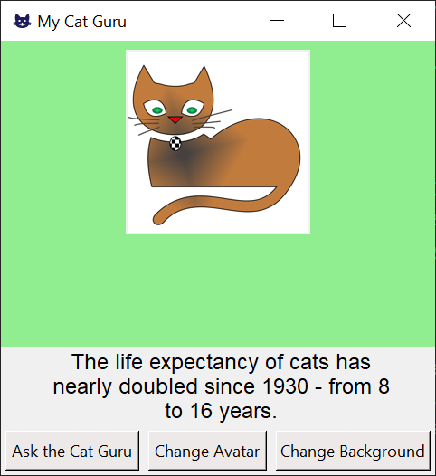
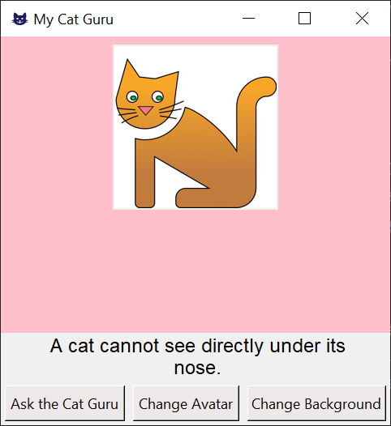
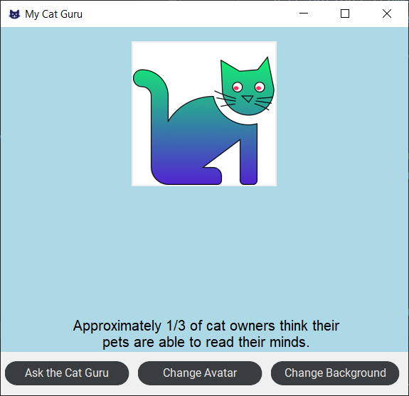
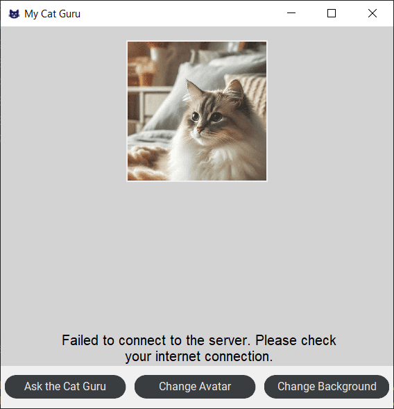

# Cat Guru

  
  
  
  
  
  
  
   

  
  
  
  
  
   

  

Bored? Ask Cat Guru for a random cat fact and be amazed! Based on Cat Facts API: https://catfact.ninja/fact

The application was created using the Tkinter framework and icons / pictures using Figma. 

## User Documentation
Cat Guru is a desktop application that generates random cat facts and allows users to change the background and avatar.

## Usage
1. Launch the application.
2. Click the "Ask the Cat Guru" button.
3. Read the cat fact that is displayed.
4. Change the background and avatar to your liking.

## Features
- "Ask the Cat Guru" button: Generates a new cat fact.
  
   
  
- "Change Avatar" button: Allows you to choose a new one avatar.
  
   
  
- "Change Background" button: Allows you to choose a new one background.

   

## Improving Error Handling with Specific Messages
- To provide more informative error messages, the get_cat_fact function handles specific exceptions and return tailored messages. Logging is used. The file cat_guru.log is created.

  

## Author
Lovingly crafted by [Hanka Robovska](https://github.com/hrosicka) 👩‍🔬

## License
MIT – Free to use, modify, and distribute as needed.

